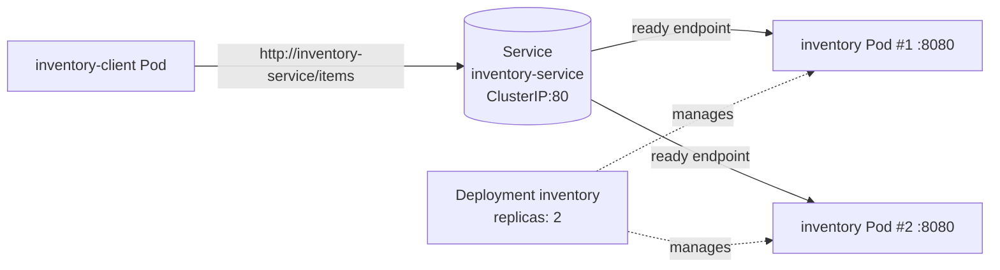

# Module 6 – Kubernetes Service Discovery, Readiness, and Pod Replacement

A small **Inventory Service** (2 replicas) and a **client** that calls it only through the
Kubernetes Service name `inventory-service`. The cluster runs on **kind** (Kubernetes in Docker)
on top of Docker Desktop.


## How it works

- `GET /items` returns the inventory **and the name/IP of the Pod that served it**, so the client
  log shows exactly which replica handled each request.
- `GET /ready` is the readiness probe target. It returns `200` normally and `503` if the file
  `/tmp/unready` exists inside the container. This lets us fail readiness on one Pod with
  `kubectl exec <pod> -- touch /tmp/unready` without killing the process.
- `GET /healthz` is the liveness probe. It always returns `200`, so a Pod that fails readiness is
  **not restarted** — it simply stops receiving Service traffic.
- The client opens a new connection for every request, so kube-proxy picks a backend each time.

## Deploying

Prerequisites: Docker (Docker Desktop), `kind`, `kubectl`.

```bash
brew install kind            # if not installed
./scripts/deploy.sh          # create cluster, build + load image, apply manifests
./scripts/demo.sh            # run all three experiments, writes evidence/*.txt
```


## Architecture

```
  kind cluster (namespace: default)

  ┌──────────────────────┐
  │ inventory-client Pod │   GET http://inventory-service/items
  └──────────┬───────────┘
             │  cluster DNS: inventory-service -> 10.96.45.26
             ▼
  ┌────────────────────────────────────┐
  │ Service: inventory-service         │
  │ ClusterIP 10.96.45.26:80           │
  │ selector: app=inventory            │
  │ routes only to READY endpoints     │
  └──────────┬──────────────┬──────────┘
             │  kube-proxy  │  load balancing
             ▼              ▼
  ┌────────────────┐  ┌────────────────┐
  │ inventory Pod  │  │ inventory Pod  │
  │ replica 1      │  │ replica 2      │
  │ :8080          │  │ :8080          │
  └────────────────┘  └────────────────┘
     managed by Deployment "inventory" (replicas: 2)
```



## Evidence

Full, unedited output is in [evidence/](evidence/). Key parts below.

### 1. Deployment — both Pods running, client uses the Service name, both replicas receive traffic

From [evidence/part1-deploy.txt](evidence/part1-deploy.txt):

```
$ kubectl get pods -o wide
NAME                                READY   STATUS    RESTARTS   AGE   IP
inventory-54699775cc-89dpg          1/1     Running   0          9s    10.244.0.6
inventory-54699775cc-rd67c          1/1     Running   0          9s    10.244.0.5
inventory-client-5899f6f4f5-bd52z   1/1     Running   0          8s    10.244.0.7

$ kubectl get svc inventory-service
NAME                TYPE        CLUSTER-IP    EXTERNAL-IP   PORT(S)   AGE
inventory-service   ClusterIP   10.96.45.26   <none>        80/TCP    9s

# Client resolves the Service name through cluster DNS:
inventory-service -> 10.96.45.26

$ kubectl logs deployment/inventory-client --tail=10
19:32:17 OK  served_by=inventory-54699775cc-89dpg pod_ip=10.244.0.6
19:32:18 OK  served_by=inventory-54699775cc-89dpg pod_ip=10.244.0.6
19:32:19 OK  served_by=inventory-54699775cc-rd67c pod_ip=10.244.0.5
19:32:20 OK  served_by=inventory-54699775cc-89dpg pod_ip=10.244.0.6
19:32:21 OK  served_by=inventory-54699775cc-rd67c pod_ip=10.244.0.5
...

# Requests per replica over the last 20 seconds:
  11 served_by=inventory-54699775cc-89dpg
   9 served_by=inventory-54699775cc-rd67c
```

The client is configured with only `INVENTORY_URL=http://inventory-service/items`; requests are
spread across **both** replicas.

### 2. Readiness failure and recovery

From [evidence/part2-readiness.txt](evidence/part2-readiness.txt):

```
# Making inventory-54699775cc-89dpg fail its readiness probe
$ kubectl exec inventory-54699775cc-89dpg -- touch /tmp/unready

$ kubectl get pods -l app=inventory -o wide
NAME                         READY   STATUS    RESTARTS   AGE   IP
inventory-54699775cc-89dpg   0/1     Running   0          36s   10.244.0.6    <-- Running but NOT ready
inventory-54699775cc-rd67c   1/1     Running   0          36s   10.244.0.5

$ kubectl get endpointslices ... (ip / pod / ready)
10.244.0.5   inventory-54699775cc-rd67c   ready=true
10.244.0.6   inventory-54699775cc-89dpg   ready=false   <-- removed from Service rotation

$ kubectl describe pod inventory-54699775cc-89dpg
Status:           Running
    Ready:          False
    Restart Count:  0
  Warning  Unhealthy  ...  Readiness probe failed: HTTP probe failed with statuscode: 503

# Pod is still running - it answers directly on its own IP:
{"status": "alive", "pod": "inventory-54699775cc-89dpg"}

# Requests per replica during the 15s that 89dpg was unready:
  15 served_by=inventory-54699775cc-rd67c        <-- 100% to the ready Pod, 0 errors
```

Restoring readiness:

```
$ kubectl exec inventory-54699775cc-89dpg -- rm /tmp/unready

$ kubectl get pods -l app=inventory -o wide
inventory-54699775cc-89dpg   1/1     Running   0          58s   10.244.0.6
inventory-54699775cc-rd67c   1/1     Running   0          58s   10.244.0.5

10.244.0.5   inventory-54699775cc-rd67c   ready=true
10.244.0.6   inventory-54699775cc-89dpg   ready=true

# Requests per replica in the 15s after recovery:
   7 served_by=inventory-54699775cc-89dpg        <-- receiving traffic again
   7 served_by=inventory-54699775cc-rd67c
```

The unready Pod kept running (Restart Count 0, `/healthz` still answered), but the Service stopped
sending it traffic until its readiness probe passed again.

### 3. Pod deletion and replacement

From [evidence/part3-pod-replacement.txt](evidence/part3-pod-replacement.txt):

```
$ kubectl delete pod inventory-54699775cc-89dpg --wait=false
pod "inventory-54699775cc-89dpg" deleted

$ kubectl get pods -l app=inventory -o wide
inventory-54699775cc-89dpg   1/1     Terminating         0          74s   10.244.0.6
inventory-54699775cc-rd67c   1/1     Running             0          74s   10.244.0.5
inventory-54699775cc-wqmvr   0/1     ContainerCreating   0          1s    <none>      <-- replacement

# After recovery:
inventory-54699775cc-rd67c   1/1     Running       0          80s   10.244.0.5
inventory-54699775cc-wqmvr   1/1     Running       0          7s    10.244.0.8   <-- new name, new IP

$ kubectl get svc inventory-service
NAME                TYPE        CLUSTER-IP    EXTERNAL-IP   PORT(S)   AGE
inventory-service   ClusterIP   10.96.45.26   <none>        80/TCP    80s   <-- same name, same ClusterIP

# ReplicaSet events:
7s   Normal   SuccessfulCreate   replicaset/inventory-54699775cc   Created pod: inventory-54699775cc-wqmvr

# Requests per replica in the last 15s (new Pod is serving):
   6 served_by=inventory-54699775cc-rd67c
   9 served_by=inventory-54699775cc-wqmvr
```

The client log across the whole deletion window ([full log](evidence/part3-pod-replacement.txt))
shows 39 consecutive `OK` responses and **zero errors**. The client was never reconfigured — it
kept calling `inventory-service`, and the Service automatically picked up the new Pod
(`wqmvr`, `10.244.0.8`) in place of the deleted one (`89dpg`, `10.244.0.6`).

> Note: the deleted Pod lingers in `Terminating` for up to 30 s (the default grace period)
> because the simple Python server doesn't handle `SIGTERM`. It is already marked not-ready in the
> EndpointSlice, so it receives no new traffic during that time.

## Reflection

**Why is a stable Service name useful when Pods can fail or be replaced?**

Pods are disposable: when one is deleted or crashes, the Deployment creates a replacement with a
new name and a new IP address, as we saw when `89dpg` (10.244.0.6) was replaced by `wqmvr`
(10.244.0.8). If the client had hard-coded Pod IPs, it would have broken the moment that Pod went
away. The Service gives clients one stable DNS name and ClusterIP (`inventory-service` →
10.96.45.26) that never changed during the whole lab, while Kubernetes keeps the list of backends
behind it up to date automatically. Combined with readiness probes, this means the Service routes
only to Pods that are actually able to serve, so failures, recoveries, and replacements are
invisible to the client — it just keeps calling the same name.
